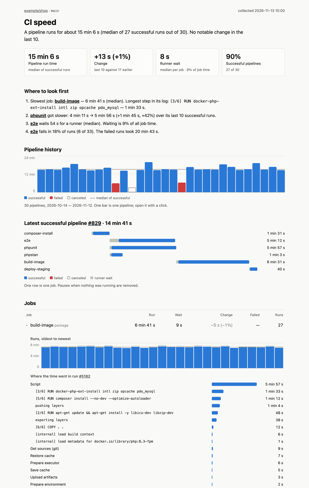

[English](README.md) | [Русский](README.ru.md)

# GitLab CI Performance

Find where GitLab CI time goes. This agent skill reads the recent pipelines of
one branch and writes one HTML report. The report shows how long a pipeline
runs, which jobs take the time, what became slower, and which steps inside the
slowest jobs are long.

The skill only reads GitLab data. It does not change CI configuration or runners.

Current version: 0.1.0. See the [changelog](CHANGELOG.md).



See the example report in [English](examples/report.html) or
[Russian](examples/report-ru.html). Download the HTML file and open it.
The example uses synthetic data.

## What you need

- Python 3.9 or later. No packages.
- [`glab`](https://gitlab.com/gitlab-org/cli) with a login for your GitLab host:
  `glab auth login --hostname gitlab.example.com`.

## Install

Run these commands from your project directory:

```sh
git clone --depth 1 https://github.com/mesilov/gitlab-ci-performance-skill.git /tmp/ci-skill
mkdir -p .agents/skills .codex/skills .claude/skills
cp -R /tmp/ci-skill/skills/gitlab-ci-performance .agents/skills/
ln -s ../../.agents/skills/gitlab-ci-performance .codex/skills/gitlab-ci-performance
ln -s ../../.agents/skills/gitlab-ci-performance .claude/skills/gitlab-ci-performance
```

To update, delete `.agents/skills/gitlab-ci-performance` and copy the new
directory to the same place. The links still work.

## Use

Ask your agent why CI is slow, or run `$gitlab-ci-performance` in Codex or
`/gitlab-ci-performance` in Claude Code.

You can also run the script yourself from the project checkout:

```sh
python3 .agents/skills/gitlab-ci-performance/scripts/ci_report.py
```

The script takes the host and project from the `origin` remote and uses the
default branch. It writes two files and prints the main findings:

- `ci-report/report.html`: the report. One file, no network, no JavaScript.
- `ci-report/data.json`: the data that the script read.

| Option | Meaning | Default |
| --- | --- | --- |
| `--host`, `--project` | GitLab host and `group/project` path | `origin` remote |
| `--ref` | branch or tag | default branch |
| `--any-ref` | do not filter by ref | off |
| `--source` | one pipeline source: `push`, `schedule`, `merge_request_event`… | all |
| `--pipelines N` | finished pipelines to read, 1–100 | 30 |
| `--logs N` | read the log of the N slowest jobs | 5 |
| `--lang en\|ru` | report language | `en` |
| `--out DIR` | output directory | `./ci-report` |
| `--from data.json` | build the report again from saved data, without GitLab | |

## Read the report

1. **Summary.** Four numbers: pipeline run time, its change, runner wait, and
   the share of successful pipelines.
2. **Where to look first.** Up to four facts: the slowest job, a job that
   became slower, a job that waits for a runner, and a job that fails often.
3. **Pipeline history.** One bar is one pipeline. A click opens it in GitLab.
4. **Latest successful pipeline.** Its jobs on one time axis. You can see which
   jobs run together and which job everything waits for.
5. **Jobs.** Sorted by run time. Open a job to see its runs and the steps from
   its log: runner phases, script commands and Docker build steps.

## How the numbers are counted

- **Pipeline run time** is the time when at least one job was running. Retries
  count. Runner waits and pauses before manual jobs do not.
- **Medians** use successful runs only.
- **Change** compares the newest successful runs (up to 10) with the earlier
  ones. The report marks a change only above 20% and 30 seconds. A comparison
  needs 6 successful runs.
- **Steps** come from the log of one run: the latest successful run of each of
  the slowest jobs. They are an example, not an average.
- Script commands have a time only when the job log has timestamps. This is the
  default in current GitLab. See [Job logs](https://docs.gitlab.com/ci/jobs/job_logs/).

## Limits

- One ref per report, or all refs together with `--any-ref`. If your CI runs
  on release tags, use `--any-ref --source push`. For merge request pipelines,
  use `--any-ref --source merge_request_event`. The script tells you when most
  pipelines are not on the default branch.
- The script does not read jobs of child and downstream pipelines.
- The report contains job names, command lines and links from your project.
  Check it before you share it outside your team.

## Development

```sh
python3 -m unittest discover -s tests -v
python3 examples/make_demo.py
```

The first command runs the tests. The second one builds the example data and
both example reports again.

MIT — see the [license](LICENSE).
