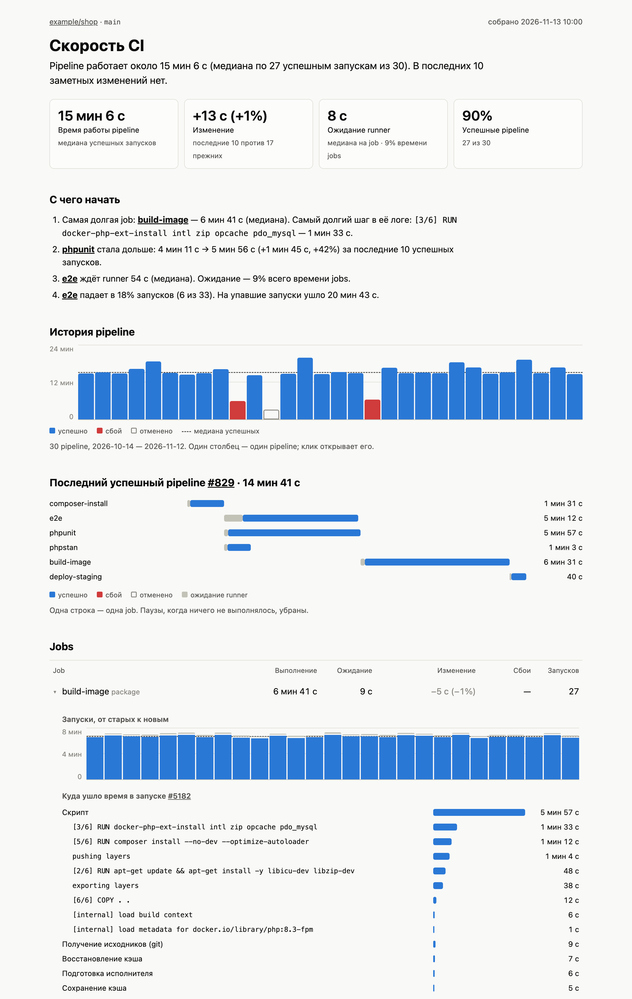

[English](README.md) | [Русский](README.ru.md)

# GitLab CI Performance

Узнайте, на что уходит время в GitLab CI. Этот скилл для агента читает последние
pipeline одной ветки и создаёт один HTML-отчёт. В отчёте видно, сколько работает
pipeline, какие jobs занимают время, что стало медленнее и какие шаги внутри
самых долгих jobs длятся дольше всего.

Скилл только читает данные GitLab. Он не меняет настройки CI и runner.

Текущая версия: 0.1.0. См. [историю изменений](CHANGELOG.md).



Посмотрите пример отчёта [на русском](examples/report-ru.html) или
[на английском](examples/report.html). Скачайте HTML-файл и откройте его.
Пример построен на синтетических данных.

## Что нужно

- Python 3.9 или новее. Пакеты не нужны.
- [`glab`](https://gitlab.com/gitlab-org/cli) с доступом к вашему GitLab:
  `glab auth login --hostname gitlab.example.com`.

## Установка

Выполните команды из каталога вашего проекта:

```sh
git clone --depth 1 https://github.com/mesilov/gitlab-ci-performance-skill.git /tmp/ci-skill
mkdir -p .agents/skills .codex/skills .claude/skills
cp -R /tmp/ci-skill/skills/gitlab-ci-performance .agents/skills/
ln -s ../../.agents/skills/gitlab-ci-performance .codex/skills/gitlab-ci-performance
ln -s ../../.agents/skills/gitlab-ci-performance .claude/skills/gitlab-ci-performance
```

Для обновления удалите `.agents/skills/gitlab-ci-performance` и скопируйте новый
каталог на то же место. Ссылки продолжат работать.

## Использование

Спросите агента, почему CI работает медленно, или вызовите
`$gitlab-ci-performance` в Codex или `/gitlab-ci-performance` в Claude Code.

Скрипт можно запустить и самому из каталога проекта:

```sh
python3 .agents/skills/gitlab-ci-performance/scripts/ci_report.py --lang ru
```

Скрипт берёт хост и проект из remote `origin` и использует основную ветку.
Он создаёт два файла и печатает главные выводы:

- `ci-report/report.html` — отчёт. Один файл, без сети и без JavaScript.
- `ci-report/data.json` — данные, которые прочитал скрипт.

| Параметр | Что значит | По умолчанию |
| --- | --- | --- |
| `--host`, `--project` | хост GitLab и путь `group/project` | remote `origin` |
| `--ref` | ветка или тег | основная ветка |
| `--any-ref` | не фильтровать по ref | выключено |
| `--source` | один источник pipeline: `push`, `schedule`, `merge_request_event`… | все |
| `--pipelines N` | сколько завершённых pipeline читать, 1–100 | 30 |
| `--logs N` | читать лог у N самых долгих jobs | 5 |
| `--lang en\|ru` | язык отчёта | `en` |
| `--out DIR` | каталог для результата | `./ci-report` |
| `--from data.json` | собрать отчёт заново из сохранённых данных, без GitLab | |

## Как читать отчёт

1. **Итог.** Четыре числа: время работы pipeline, его изменение, ожидание runner
   и доля успешных pipeline.
2. **С чего начать.** До четырёх фактов: самая долгая job, job, которая стала
   дольше, job, которая ждёт runner, и job, которая часто падает.
3. **История pipeline.** Один столбец — один pipeline. Клик открывает его в GitLab.
4. **Последний успешный pipeline.** Его jobs на одной оси времени. Видно, какие
   jobs идут одновременно и какую job ждут все остальные.
5. **Jobs.** Отсортированы по времени выполнения. Откройте job, чтобы увидеть её
   запуски и шаги из лога: фазы runner, команды скрипта и шаги сборки Docker.

## Как считаются числа

- **Время работы pipeline** — время, когда выполнялась хотя бы одна job.
  Перезапуски входят. Ожидание runner и паузы перед ручными jobs — нет.
- **Медианы** считаются только по успешным запускам.
- **Изменение** сравнивает последние успешные запуски (до 10) с предыдущими.
  Отчёт выделяет изменение, только если оно больше 20% и 30 секунд.
  Для сравнения нужно 6 успешных запусков.
- **Шаги** взяты из лога одного запуска: последнего успешного у каждой из самых
  долгих jobs. Это пример, а не среднее.
- У команд скрипта есть время, только если в логе job есть метки времени.
  В текущих версиях GitLab они включены по умолчанию.
  См. [Job logs](https://docs.gitlab.com/ci/jobs/job_logs/).

## Ограничения

- Один ref на отчёт или все ref вместе с `--any-ref`. Если CI запускается на
  релизных тегах, используйте `--any-ref --source push`. Для pipeline из merge
  request — `--any-ref --source merge_request_event`. Скрипт подскажет, если
  большинство pipeline идёт не на основной ветке.
- Скрипт не читает jobs дочерних и downstream-pipeline.
- В отчёте есть имена jobs, строки команд и ссылки из вашего проекта.
  Проверьте его перед отправкой за пределы команды.

## Разработка

```sh
python3 -m unittest discover -s tests -v
python3 examples/make_demo.py
```

Первая команда запускает тесты. Вторая заново создаёт данные примера и оба
примера отчёта.

MIT — [лицензия](LICENSE).
